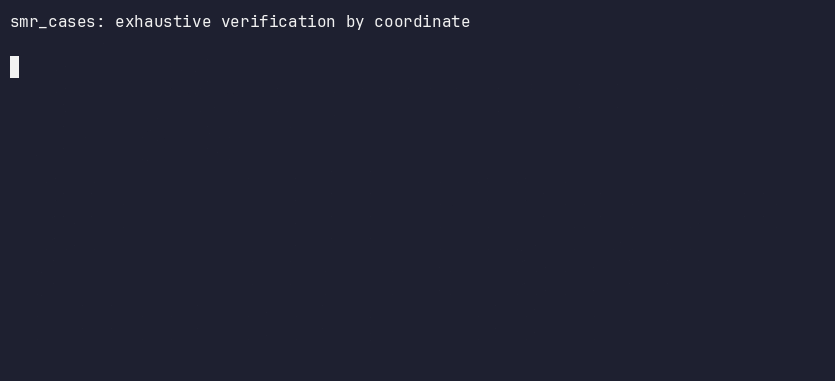

# Exhaustive verification by coordinate



An example of exhaustive state-space verification read as coordinates instead of
scanned. The space is declared (fields and domains), the rules are declared, and
each admissible point is classified from its own coordinates; a rejected
combination is never generated. The record states the counts and the address of
the spec that produced them.

The axis values are placeholders. They are named after a design-basis matrix so
the space reads like a familiar one, and they model no code, component, or
plant. Any declared space is read the same way.

## The space

| Field | Values | Meaning |
|---|---|---|
| `revision` | 0..2 | design revision |
| `load_case` | 0..11 | load combination entries |
| `region` | 0..4 | nozzle, shell, head, support, flange |
| `material` | 0..2 | SA-508 Gr.3 Cl.1, SA-533 Type B Cl.1, 316L |
| `method` | 0..1 | design by formula, design by analysis |

Raw space: 3 x 12 x 5 x 3 x 2 = 1,080 combinations.

### Declared load-case entries

These are the entries this space declares. They are not a code table; a real
instance replaces them with the ones its plant design specification states.

| Index | Entry | Declared combination |
|---|---|---|
| 0 | design | `P_des + D` |
| 1 | Level A | `P_o + D + T` |
| 2 | Level B | `P_o + D + T + OBE` |
| 3 | Level C | `P_o + D + T + SSE` |
| 4 | Level D | `P_o + D + T + SSE faulted` |
| 5 | hydrostatic test | `1.25 P_des` |
| 6 | pneumatic test | `1.10 P_des` |
| 7 | Level A, fatigue | `P_o + D + T + OBE`, fatigue evaluation |
| 8 | Level B, relief valve | `P_o + D + T + OBE + SRV` |
| 9 | Level C, pipe break | `P_o + D + T + SSE + pipe break` |
| 10 | Level D, pipe break | `P_o + D + T + SSE faulted + pipe break` |
| 11 | design with OBE | `P_des + D + OBE` |

Two rules narrow it, and both are encoded into the enumeration, so a rejected
combination is never emitted as a point:

| Rule | Statement |
|---|---|
| `region` to `material` | a support is 316L only; a nozzle and a flange take SA-508 or 316L; a shell and a head take SA-508 or SA-533 |
| `load_case` to `method` | the hydrostatic and pneumatic test entries require design by analysis; every other entry admits both |

Admissible: 3 x (2 + 2 + 2 + 1 + 2) x (10 x 2 + 2 x 1) = 594. Rejected: 486.

## Run

```bash
./run.sh              # summary, exit status, and the record identity
./run.sh --raw        # the engine's own text output
./run.sh --json       # the Fact envelope
./run.sh --record     # the stable payload
./run.sh --reproduce  # payload identical across runs, envelope stamp moves
./demo.sh             # records demo.cast, then plays the steps
```

The comparison with SQLite is a Rust example in the parent crate:

```bash
cargo run --release --example store_compare --features store-compare
```

`ev verify` exits 1 when the declared space contains a rejected combination.
That is a verdict on the space, so `run.sh` prints the status as a value.

## Expected output

```text
smr_nsss_case_space

  spec       space.xif.yaml
  spec_hash  dd108e8924cb308f5af9e0eca930358fd3b1487f42fa5127d026100a3f3a910a
  engine     ev/structural 0.1.0
  claim      exhaustive

  declared           1,080   combinations the spec declares
  admissible           594   combinations the rules admit, emitted and classified
  rejected             486   combinations the rules exclude, never generated

  exit                   1   1 means the space has rejected combinations

The admissible set is the case list. No allowable is evaluated.
```

The record carries the summary and the spec address. The per-point rows are
opt-in (`--rows`, or `--sample N` for the first N), because they are what cost:
the 828,000-point study space writes 361 bytes without them and 317 MB with
them.

`./run.sh --reproduce` prints the payload hash twice and the envelope stamp for
each run:

```text
payload hash, run 1: 8a443eded22d93f948857c8b35fca11bcd93864a3325eb613f4e1754995cde34
payload hash, run 2: 8a443eded22d93f948857c8b35fca11bcd93864a3325eb613f4e1754995cde34
envelope stamp, run 1: 2026-11-09T10:18:54.640526+00:00
envelope stamp, run 2: 2026-11-09T10:18:54.657137+00:00
payloads identical
```

Both hashes are tied to the spec: a change to a domain, a rule, or the
projector changes `spec_hash` and therefore the payload hash. The stamps differ
by construction.

## Scan or coordinate

`ev` carries both readers of one spec. `EV_CLASSIFIER=naive` enumerates the
declared product and tests every combination; the default walks the admissible
set. The counts are identical and the cost is not.

| Space | Declared | Admitted | naive | default |
|---|---|---|---|---|
| `space.xif.yaml` | 1,080 | 594 | 0.00 s, 4 MB | 0.00 s, 4 MB |
| `study.xif.yaml` | 1,440,000 | 828,000 | 0.3 s, 400 MB | 0.15 s, 200 MB |
| `enable_mask_demo` fixture | 524,288 | 4,096 | 0.1 s, 144 MB | 0.00 s, 5 MB |

The scan pays the declared product; the coordinate reader pays the admitted set.
The two converge where the rules admit most of the space, as in the first two
rows. The third row admits 0.8 percent and is the point: the scan holds 144 MB
to reach 4,096 points, and the coordinate reader holds 5 MB.

The third row is a repository fixture, `tests/fixtures/common/enable_mask_demo.xif.yaml`,
not part of this example. It declares a space whose rules reject 99.2 percent of
it. Figures are one run and move a little.

## Scale

`study.xif.yaml` applies the same two rules to a design-of-experiments space:
2,000 geometry variants, 24 load cases, 5 regions, 3 materials, 2 methods.

| Spec | Declared | Admissible | Wall | Peak RSS | Record |
|---|---|---|---|---|---|
| `space.xif.yaml` | 1,080 | 594 | 0.00 s | 4 MB | 658 B |
| `study.xif.yaml` | 1,440,000 | 828,000 | 0.13 s | 188 MB | 675 B |

`total` is the size of the declared product, computed from the domain
cardinalities without enumerating it. `passed` is the number of points the
engine emitted and classified. Memory follows the emitted count at roughly 230
bytes a point, so a space with tens of millions of admissible points does not
fit this pipeline; the streaming path is a separate, open item. The record
above is the summary: `--rows` on the study space writes 317 MB instead.

```bash
SPEC=study.xif.yaml ./run.sh
```

## Against an indexed database

`store_compare` holds the same 828,000 points twice, in one process: a
coordinate array addressed by arithmetic, and SQLite. Both sides are Rust, so
neither pays another language's overhead.

```bash
cargo run --release --example store_compare --features store-compare
```

| | coordinate | sqlite | sqlite, 2 indexes | sqlite, 3 indexes |
|---|---|---|---|---|
| size | 2.7 MiB | 15.3 MiB | 38.7 MiB | 47.3 MiB |
| load, insert | 1 ms | 0.2 s | 0.2 s | 0.2 s |
| load, build indexes | none | none | 0.4 s | 0.7 s |
| query, five axes | 1.4 ns | 22.5 ms | 8.9 us | 8.9 us |
| query, region and material | 1.4 ms | 27.0 ms | 27.0 ms | 9.4 us |

Read the rows in this order.

- The keyed lookup is arithmetic on the address: 1.4 ns, against 8.9 us once
  the index exists.
- A subset query has no address to compute, so both sides scan. The coordinate
  side decodes an integer, 1.4 ms; SQLite walks rows, 27.0 ms.
- An index makes that subset 9.4 us. The price is both rows above it: about
  8.6 MiB and half a second of build time for one index.
- Five axes have 31 non-empty subsets. The two-index database covers 3 of them,
  the three-index one covers 4.

Why this is the fair comparison, and where it still is not.

- Both sides are Rust in one process, with SQLite bundled through rusqlite.
- Probe tuples are built before any timing, so neither side pays for generating
  them inside the measured loop, and each SQLite measurement runs one warm query
  first.
- Insert and index build are reported apart, because the coordinate store has
  no build step to compare against an index.
- The coordinate array holds payload only; the axes are the address. SQLite
  stores the key columns and the payload. That asymmetry is the claim, not a
  measurement error, but a reader should see it stated.
- The subset scan on the coordinate side walks 1,440,000 slots while SQLite
  walks 828,000 rows, so the coordinate side does more work there and still
  finishes sooner.
- Figures are one run; they move a little.

## Recording the demo

`demo.sh` records itself. Running it refreshes `demo.cast` next to the script
and then plays the same steps, so the file and what you just watched are one
run.

```bash
./demo.sh              # record, about 20 s, and refresh demo.cast
./demo.sh --play       # the steps without recording
DEMO_PAUSE=5 ./demo.sh # a slower beat between screens
```

`asciinema play demo.cast` replays it, `asciinema upload demo.cast` prints a
URL, and `asciinema convert demo.cast demo.txt` writes a plain text transcript.
An uploaded cast is readable by anyone with the link, so read it once before
sharing. Inside a recording (`ASCIINEMA_REC` set) the script plays rather than
records, so the call does not recurse, and an absent `asciinema` falls back to
playing.

## What the record carries

| Field | Meaning |
|---|---|
| `spec_hash` | identity of the spec; a change to a domain, a rule, or the projector changes it |
| `engine`, `claim` | which engine classified, and what it claims (`exhaustive`) |
| `total`, `passed`, `failed` | declared points, admissible points, rejected points |
| `emitted` | points the engine generated and classified |
| `row_policy` | `omitted`, `sample`, or `all`; the rows are a function of the spec, so the summary addresses it and leaves them to a re-run |
| `point_id` | identity of a coordinate, verdict excluded |
| `id` | identity of the observation, verdict and projection included |

The payload is identical across runs. The envelope adds a timestamp and an
origin, which is why two `--json` runs differ and two `--record` runs do not.

## What the demo establishes

- The admissible set follows from the declared rules, so the case list is
  derived rather than hand-kept.
- The scan pays the declared product and the coordinate reader pays the admitted
  set; the raw product is counted without enumeration.
- The record is addressed by `spec_hash` and reproduces byte for byte; the
  counts are re-derivable from the spec the hash names.
- An axis subset needs no stored index: the address carries the axes, so the
  subset is a scan over addresses rather than over rows.

## What it does not establish

- That the rules match a design basis. A wrong rule gives a confident wrong
  count, and no test in this repository can catch it, because the truth is
  outside the spec.
- That any case was run, or that it met an allowable. No allowable is
  evaluated; the verdict is admissibility, not a stress or temperature check.
- That the comparison matches another workflow. It is one baseline, SQLite on
  one machine, with Python's call overhead included.
- Whether each admissible case met its allowables is a separate input. A second
  spec over assessment results would carry it.

## Using it on a real case list

Replace the synthetic domains with the plant's declared load combinations,
regions, materials, and methods, and replace the two rules with the ones the
design basis states. The question stays the same, and `spec_hash` becomes the
identity of that case list: two studies with the same hash declared the same
cases.
